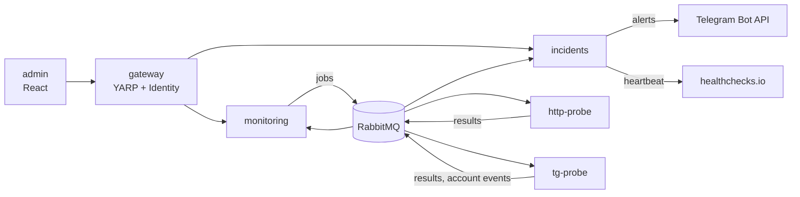

# BotWatch

Self-hosted monitoring for Telegram bots. BotWatch talks to your bots the way a real user does — through a
userbot account over MTProto — so it works for bots behind long polling, with no public URL and no open ports.
HTTP checks are there too, for the odd website or API. Alerts arrive in Telegram via the Bot API.

```text
/status every 5 min          → reply contains "active"           ✔
random phrase every 3 hours  → any reply within 60 s             ✔
voice message once a day     → reply is a voice within 120 s     ✘  → alert after 2 failures
```

> [!WARNING]
> **Your Telegram account can be banned.** Automated activity on a user account is a grey area for Telegram.
> - Use a **separate account** for checks, never your main number.
> - Keep it to **2–3 checker accounts per IP address**.
> - BotWatch enforces hard limits that cannot be loosened from the UI: Telegram checks no more often than every
>   **5 minutes**, at most **30 sent messages per account per hour**, at least 3 seconds between messages, and
>   `FLOOD_WAIT` is honoured by pausing the account. Do not patch these limits out.
> - Prefer cheap checks (commands like `/status`) for frequent runs and leave expensive ones
>   (LLM replies, voice) for a few times a day — they cost your bot money, not just BotWatch's budget.

## Features

- **Scenario checks** for bots: send text, commands, a random phrase from a pool, voice notes; click inline
  buttons; expect a reply that contains text, matches a regex, has a button, is a voice or a file.
- **HTTP checks**: method, expected status, body substring, timeout.
- **Incidents**: opened after 2 consecutive failures, resolved on the first success, with Telegram alerts both ways.
- **Stale detection**: if no results arrive for 2.5× the interval, you get "the check is not running" —
  the probe is down or the checker account was logged out.
- **Dead man's switch**: the incidents service pings an external URL (e.g. healthchecks.io) every minute,
  so you learn when BotWatch itself is down.
- **Several checker accounts**, signed in by QR code from the admin UI. Sessions and bot tokens are encrypted at rest.
- **Admin UI** (React + TypeScript) with a JSON scenario editor, uptime charts and a public status page.
- **Observability**: OpenTelemetry traces that follow a message through the outbox and RabbitMQ,
  Prometheus metrics and a ready-made Grafana dashboard.

## Quick start (Docker Compose)

Requirements: Docker with Compose v2, and a Telegram app from <https://my.telegram.org> → *API development tools*
(only `api_id` and `api_hash`; checker accounts sign in by QR, no phone codes in config).

```bash
cd deploy/compose
cp .env.example .env
# fill in every value; the encryption key is 32 random bytes:
openssl rand -base64 32
docker compose up -d --build
```

Open <http://localhost:8080> (or `BOTWATCH_PORT`), create the admin user in the first-run wizard, then:

1. **Alert channels** — add a bot token from @BotFather and the chat id to send alerts to.
2. **Telegram accounts** — add an account and scan the QR code with the checker account's Telegram app.
3. **Overview → New monitor** — a bot (`@username`) or a website, then add checks.

To expose BotWatch to the internet, put it behind a reverse proxy with HTTPS and set `BEHIND_PROXY=true`.
Only the gateway port is published; everything else stays on the internal network.

If Telegram is blocked where you run BotWatch, set `TELEGRAM_PROXY` (SOCKS5) or `TELEGRAM_MTPROXY_URL`.

### Metrics and dashboard

```bash
docker compose --profile observability up -d
```

| Tool | URL | What for |
|---|---|---|
| Grafana | <http://localhost:3001> | BotWatch dashboard: checks by status, runs, p95 duration, outbox lag, account budget |
| Prometheus | <http://localhost:9091> | Raw metrics, scraped from port 9464 of each service |
| Seq | <http://localhost:5380> | Logs and traces |
| RabbitMQ | <http://localhost:15680> | Queues |

All of them listen on `127.0.0.1` only.

## Kubernetes

Plain manifests for a single-node k3s live in [deploy/k8s](deploy/k8s), applied with `kubectl apply` in numbered order:
StatefulSets for Postgres and RabbitMQ, Deployments with startup/liveness/readiness probes, an hourly CronJob for history rollup,
Traefik Ingress with cert-manager, default-deny NetworkPolicies and KEDA autoscaling for the probes
(HTTP by queue length, Telegram by active accounts).

KEDA and cert-manager are installed into the cluster separately; secrets come from `deploy/k8s/secrets.env`
(see [secrets.env.example](deploy/k8s/secrets.env.example)). A Helm chart is next on the roadmap.

## Architecture



| Service | Responsibility | Database |
|---|---|---|
| **gateway** | Sign-in, first-run wizard, proxying `/api/*`, public status page | `gateway` |
| **monitoring** | Monitors, checks, scenarios, scheduling, per-account budgets | `monitoring` |
| **incidents** | Results, check state, incidents, uptime, alerts, stale detection, heartbeat | `incidents` |
| **tg-probe** | Checker accounts, encrypted sessions, leases, QR sign-in, running scenarios | `tgprobe` |
| **http-probe** | Running HTTP checks, stateless | — |
| **admin** | SPA: admin UI and status page | — |

Design notes:

- **DDD**: aggregates (`Monitor`, `CheckState`, `Incident`, `TelegramAccount`) own their invariants;
  ban-protection limits live in the domain, not in the UI.
- **Database per service**. Services never read each other's tables, they exchange events.
- **Transactional outbox and inbox** on top of a thin RabbitMQ wrapper with publisher confirms —
  no event is lost on a crash and none is handled twice.
- **Probes have no inbound ports**: they consume jobs and publish results.
- **One account, one owner**: a Postgres lease makes sure two tg-probe replicas never use the same session.
- Postgres also handles scheduling and rate limits, so there is no Redis.

## Development

```bash
dotnet build BotWatch.slnx
dotnet test tests/BotWatch.Incidents.Tests   # one project at a time; integration tests use Testcontainers

cd web/admin
npm ci
npm run dev       # Vite dev server, proxies /api to the gateway
npm run lint
npm run build
```

OpenAPI snapshots of the services are checked by tests. After changing an endpoint:

```bash
BOTWATCH_UPDATE_OPENAPI=1 dotnet test tests/BotWatch.Monitoring.Tests --filter OpenApi
cd web/admin && npm run api      # regenerate TypeScript types
```

CI (GitHub Actions) builds and tests everything, checks that the TypeScript API types are up to date,
and publishes images to GHCR from `main`.

## Roadmap

- [x] HTTP and Telegram checks, incidents, alerts, admin UI, status page
- [x] Stale detection, dead man's switch, history retention, OpenTelemetry
- [x] Kubernetes: k3s with plain manifests, StatefulSets, Ingress + cert-manager, NetworkPolicy, KEDA
- [ ] Helm chart
- [ ] **LLM-generated scenarios**: describe the bot in plain words and a model drafts checks and phrase pools
      for you to review. Generation happens when you edit a check, never on every run — runs stay deterministic,
      cheap and do not burn the account budget.
- [ ] Probes in several regions
